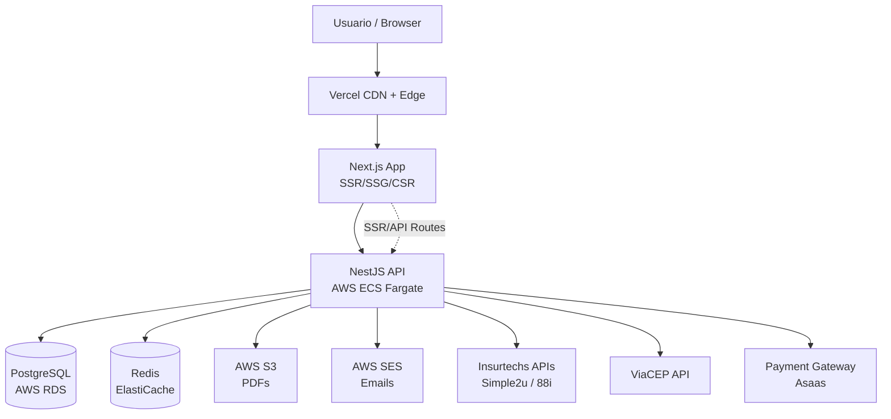

# 2. High Level Architecture

### Technical Summary

Seg360 segue uma arquitetura monolito modular em monorepo, com frontend Next.js 14+ (App Router) e backend NestJS, ambos em TypeScript. O frontend usa SSR/SSG para paginas publicas (SEO) e CSR para dashboards autenticados. O backend expoe uma REST API organizada em modulos por dominio (auth, risk, quotation, policy, broker, admin). PostgreSQL armazena dados relacionais via Prisma ORM, Redis faz cache de cotacoes e dados de risco. Integracoes com insurtechs parceiras seguem o Adapter Pattern para permitir multiplos providers. Deploy em Vercel (frontend) e AWS ECS (backend), com RDS e ElastiCache para banco e cache.

### Platform and Infrastructure Choice

**Platform:** AWS + Vercel (hibrido)
**Key Services:**
- Vercel: Hospedagem Next.js (SSR/SSG, Edge Functions, CDN global)
- AWS ECS (Fargate): API NestJS containerizada
- AWS RDS (PostgreSQL 16): Banco de dados relacional
- AWS ElastiCache (Redis 7): Cache e sessoes
- AWS SES: Envio de emails transacionais
- AWS S3: Armazenamento de arquivos (PDFs de apolice)

**Deployment Regions:** sa-east-1 (Sao Paulo) como regiao primaria

### Repository Structure

**Structure:** Monorepo com npm workspaces
**Monorepo Tool:** npm workspaces (nativo, sem overhead adicional — equipe enxuta)
**Package Organization:**
- `apps/web` — Frontend Next.js
- `apps/api` — Backend NestJS
- `packages/shared` — Tipos TypeScript, constantes, utilitarios compartilhados

### High Level Architecture Diagram

### Architectural Patterns

- **Monolito Modular:** Backend NestJS organizado em modulos por dominio, cada modulo com seus controllers, services e repositories — _Rationale:_ Simplicidade para MVP com equipe enxuta, facil evolucao para microservicos se necessario
- **Adapter Pattern (Insurtechs):** Interface abstrata `InsurtechProvider` com implementacoes concretas por parceiro — _Rationale:_ Permite adicionar/trocar insurtechs sem alterar logica de negocio
- **Repository Pattern:** Camada de acesso a dados via Prisma isolada em services — _Rationale:_ Testabilidade, isolamento de queries, facilita mock em testes
- **Server-Side Rendering + Static Generation:** Paginas publicas (landing, SEO) em SSG/ISR; dashboards em CSR com autenticacao — _Rationale:_ SEO otimo para aquisicao organica, dashboards rapidos
- **API Client Layer:** Frontend acessa backend exclusivamente via camada de services (nunca fetch direto) — _Rationale:_ Centralizacao de auth headers, error handling, tipagem
- **Guard-Based Authorization:** NestJS guards para RBAC (Consumer, Broker, Admin) — _Rationale:_ Padrao nativo NestJS, declarativo, testavel

---

