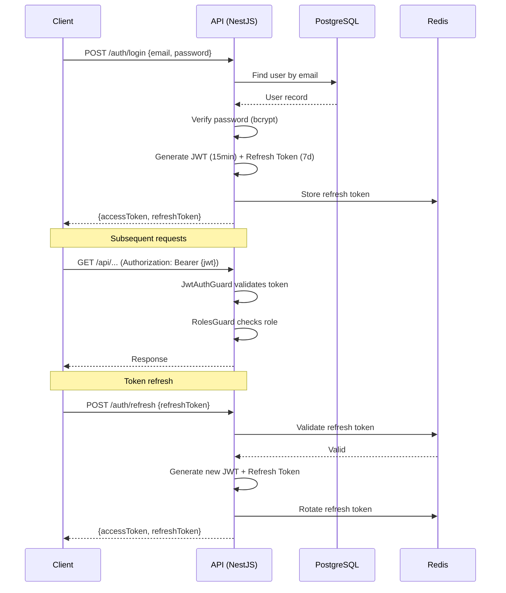

# 6. Backend Architecture

### NestJS Module Organization

```
apps/api/src/
├── main.ts
├── app.module.ts
├── common/
│   ├── decorators/        # @CurrentUser, @Roles, @Public
│   ├── filters/           # GlobalExceptionFilter
│   ├── guards/            # JwtAuthGuard, RolesGuard
│   ├── interceptors/      # LoggingInterceptor, TransformInterceptor
│   ├── pipes/             # ZodValidationPipe
│   └── types/             # Tipos comuns do backend
├── modules/
│   ├── auth/
│   │   ├── auth.module.ts
│   │   ├── auth.controller.ts
│   │   ├── auth.service.ts
│   │   ├── strategies/     # JwtStrategy, RefreshStrategy
│   │   └── dto/            # LoginDto, RegisterDto
│   ├── user/
│   │   ├── user.module.ts
│   │   ├── user.controller.ts
│   │   └── user.service.ts
│   ├── risk/
│   │   ├── risk.module.ts
│   │   ├── risk.controller.ts
│   │   ├── risk.service.ts
│   │   └── providers/      # CemademProvider, ViaCepProvider
│   ├── quotation/
│   │   ├── quotation.module.ts
│   │   ├── quotation.controller.ts
│   │   ├── quotation.service.ts
│   │   └── providers/      # InsurtechProvider interface, Simple2uAdapter, MockAdapter
│   ├── policy/
│   │   ├── policy.module.ts
│   │   ├── policy.controller.ts
│   │   ├── policy.service.ts
│   │   └── pdf/            # PolicyPdfGenerator
│   ├── payment/
│   │   ├── payment.module.ts
│   │   ├── payment.controller.ts
│   │   ├── payment.service.ts
│   │   └── providers/      # AsaasProvider, PaymentGateway interface
│   ├── broker/
│   │   ├── broker.module.ts
│   │   ├── broker.controller.ts
│   │   ├── broker.service.ts
│   │   └── lead.service.ts
│   ├── admin/
│   │   ├── admin.module.ts
│   │   ├── admin.controller.ts
│   │   └── admin.service.ts
│   └── email/
│       ├── email.module.ts
│       ├── email.service.ts
│       └── templates/       # HTML templates
├── prisma/
│   ├── schema.prisma
│   ├── migrations/
│   └── seed.ts
└── config/
    ├── app.config.ts
    ├── database.config.ts
    ├── redis.config.ts
    └── jwt.config.ts
```

### Insurtech Adapter Pattern

```typescript
// packages/shared/src/types/insurtech.ts
interface InsurtechProvider {
  readonly name: string;
  getPlans(riskTypes: RiskType[]): Promise<InsurancePlan[]>;
  getQuote(params: QuoteRequest): Promise<QuoteResponse>;
  createPolicy(params: PolicyRequest): Promise<PolicyResponse>;
}

// apps/api/src/modules/quotation/providers/simple2u.adapter.ts
class Simple2uAdapter implements InsurtechProvider {
  readonly name = 'simple2u';
  // implementacao especifica
}

// apps/api/src/modules/quotation/providers/mock.adapter.ts
class MockInsurtechAdapter implements InsurtechProvider {
  readonly name = 'mock';
  // dados mockados para desenvolvimento
}
```

### Authentication Flow



---

