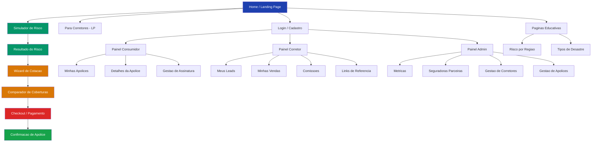
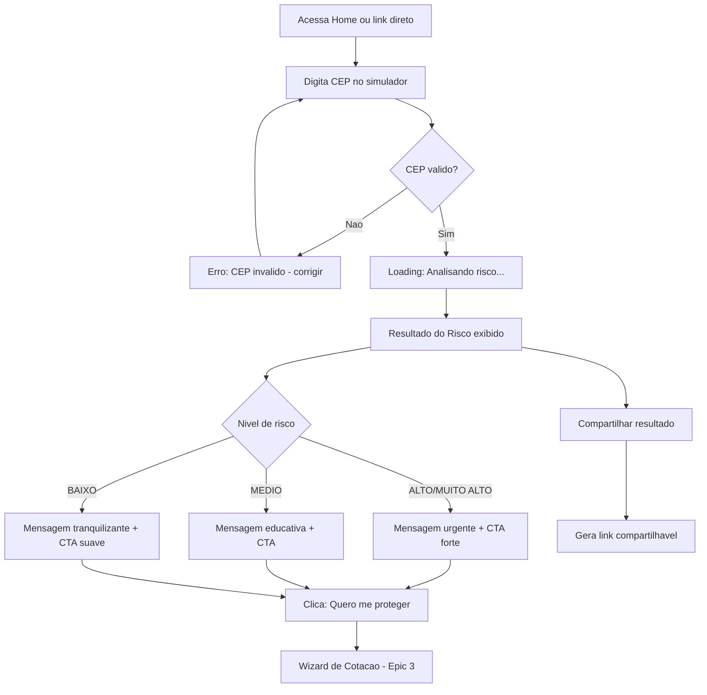
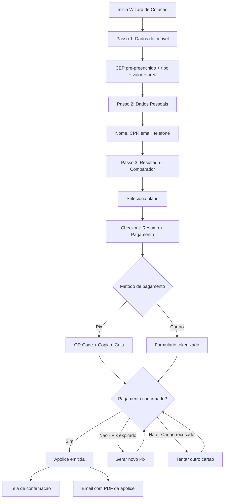
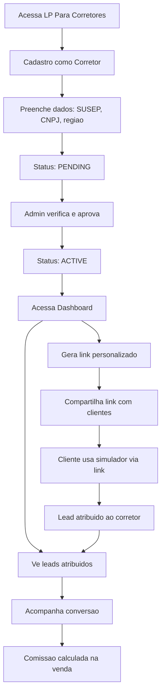

# Seg360 UI/UX Specification

## 1. Introduction

This document defines the user experience goals, information architecture, user flows, and visual design specifications for Seg360's user interface. It serves as the foundation for visual design and frontend development, ensuring a cohesive and user-centered experience.

### Overall UX Goals & Principles

#### Target User Personas

**Consumidor Final (Maria):** Proprietaria de imovel em area de risco, 30-55 anos, acessa internet pelo celular, sem conhecimento sobre seguros. Precisa entender o risco real na sua regiao e contratar protecao de forma simples. Motivada por medo de perder patrimonio, desmotivada por burocracia e linguagem tecnica.

**Corretor de Seguros (Carlos):** Corretor autonomo registrado na SUSEP, 28-50 anos, carteira concentrada em seguro auto, busca diversificar para nicho mais lucrativo. Precisa de leads quentes, ferramentas digitais e um nicho com comissao melhor (30-40% vs 10-25% do auto). Frustrado com falta de leads e operacao manual.

**Administrador (Ana):** Gestora da plataforma Seg360, perfil tecnico/business, precisa monitorar metricas, gerenciar parceiros e corretores. Foco em eficiencia operacional e visao de dados.

#### Usability Goals

- **Facilidade de aprendizado:** Consumidor deve completar simulacao de risco e cotacao na primeira visita sem instrucoes
- **Eficiencia:** Cotacao completa em < 60 segundos, contratacao em < 5 minutos
- **Prevencao de erros:** Validacao inline em todos os formularios, confirmacao antes de acoes financeiras
- **Confianca:** Cada tela deve transmitir seguranca profissional — o usuario esta lidando com protecao patrimonial
- **Acessibilidade:** Funcional para pessoas com baixo letramento digital; linguagem simples, sem jargao

#### Design Principles

1. **Confianca primeiro** — Cada elemento visual deve transmitir seguranca e profissionalismo. Cores solidas, tipografia limpa, espacamento generoso
2. **Educacao integrada** — A interface educa enquanto converte. Tooltips, textos explicativos e comparacoes visuais fazem parte do fluxo, nao sao extras
3. **Mobile-first real** — Todo design comeca no mobile (320px). Desktop e uma extensao, nao o contrario
4. **Progressao natural** — O usuario e guiado do entendimento (risco) → avaliacao (cotacao) → acao (contratacao) sem fricao
5. **Feedback imediato** — Toda acao tem resposta visual instantanea: loading states, confirmacoes, erros claros

#### Change Log

| Date | Version | Description | Author |
|------|---------|-------------|--------|
| 2026-02-13 | 1.0 | Criacao inicial a partir do PRD | BMad UX Expert |

---

## 2. Information Architecture (IA)

### Site Map / Screen Inventory

### Navigation Structure

**Primary Navigation (Header):**
- Logo (link para Home)
- Simulador de Risco
- Para Corretores
- Login / Meu Painel (condicional: se logado, mostra "Meu Painel")

**Secondary Navigation:**
- Dentro dos paineis (Consumer/Broker/Admin): sidebar com menu contextual
- Breadcrumbs em todas as paginas internas

**Breadcrumb Strategy:**
- Home > Simulador de Risco > Resultado
- Home > Cotacao > Comparar Planos > Checkout
- Home > Meu Painel > Minhas Apolices > Detalhes
- Home > Risco > Estado > Cidade (paginas SEO)

---

## 3. User Flows

### Flow 1: Risk Simulation (Jornada Principal)

**User Goal:** Descobrir o nivel de risco de calamidade na minha regiao

**Entry Points:** Home page (hero CTA), link compartilhado por corretor, pagina SEO regional, busca organica

**Success Criteria:** Usuario visualiza resultado do risco e clica em "Quero me proteger"

**Edge Cases & Error Handling:**
- CEP inexistente: "Nao encontramos esse CEP. Verifique e tente novamente"
- CEP sem dados de risco: Mostrar dados da cidade/estado com aviso "dados aproximados para sua regiao"
- API timeout: "Estamos com lentidao. Tente novamente em instantes" com botao de retry
- Rate limit excedido: "Voce fez muitas consultas. Aguarde 1 minuto"

### Flow 2: Quotation & Contracting (Cotacao ate Contratacao)

**User Goal:** Cotar e contratar seguro contra calamidade de forma rapida e digital

**Entry Points:** CTA do resultado de risco, link direto, painel do corretor

**Success Criteria:** Apolice emitida e email de confirmacao recebido

**Edge Cases & Error Handling:**
- CPF invalido: validacao em tempo real com mensagem
- Email ja cadastrado: oferecer login
- Nenhuma cotacao disponivel: "Nao encontramos planos para seu perfil. Quer que um corretor entre em contato?"
- Falha no gateway de pagamento: mensagem generica + opcao de tentar novamente
- Timeout no pagamento Pix (30min): aviso de expiracao com botao de gerar novo

### Flow 3: Broker Journey (Jornada do Corretor)

**User Goal:** Cadastrar-se, receber leads e vender seguros via plataforma

**Entry Points:** Landing page "Para Corretores", indicacao de outro corretor

**Success Criteria:** Corretor ativo com leads e vendas rastreadas

**Edge Cases & Error Handling:**
- Registro SUSEP invalido: validacao de formato, mensagem de orientacao
- Corretor nao aprovado: email explicando pendencias
- Lead duplicado: deduplicacao por email/telefone

---

## 4. Wireframes & Mockups

**Primary Design Files:** A definir (Figma) — os layouts abaixo servem como guia conceitual.

### Key Screen Layouts

#### Home / Landing Page

**Purpose:** Primeiro contato com a plataforma. Deve educar sobre o risco, mostrar a proposta de valor e direcionar para o simulador.

**Key Elements:**
- Hero: Headline impactante ("Sua casa esta protegida contra enchentes?") + campo de CEP inline + CTA
- Barra de dados: "732 bi em prejuizos | 0,14% dos lares protegidos | 3.620 alertas em 2024"
- Secao "Como Funciona": 4 passos com icones (Simule → Compare → Contrate → Proteja)
- Prova social: contador de familias protegidas, depoimentos
- FAQ expandivel
- Footer com links e contato

**Interaction Notes:** Campo de CEP no hero e o ponto focal. Ao digitar e submeter, scroll suave para resultado inline ou redirect para pagina de resultado.

#### Resultado do Simulador de Risco

**Purpose:** Mostrar o risco real de forma visual e impactante, motivar a acao.

**Key Elements:**
- Badge de nivel de risco (cor + texto: BAIXO/MEDIO/ALTO/MUITO ALTO)
- Icones de tipos de risco (enchente, deslizamento, vendaval, granizo)
- Numero de ocorrencias nos ultimos 12 meses
- Comparacao visual: "Prejuizo medio R$45.000 vs Protecao R$29/mes"
- CTA principal: "Quero me proteger" (botao grande, cor de acao)
- CTA secundario: "Compartilhar resultado" (gera link)
- Mapa contextual (opcional, melhoria futura)

**Interaction Notes:** Badge de risco com cor semantica forte (vermelho=alto, laranja=medio, verde=baixo). Animacao de entrada nos numeros para impacto visual.

#### Comparador de Coberturas

**Purpose:** Permitir decisao informada mostrando planos lado a lado.

**Key Elements:**
- Cards de planos (max 3 desktop, carrossel mobile)
- Cada card: nome, preco/mes, valor cobertura, lista de itens cobertos/nao cobertos
- Checkmarks verdes (cobre) e X vermelhos (nao cobre)
- Badge "Mais Popular" ou "Melhor Custo-Beneficio"
- Tooltips em cada item de cobertura
- Botao "Contratar" em cada card
- Filtros e ordenacao no topo

**Interaction Notes:** Hover no card destaca com sombra. Tooltip aparece ao clicar no icone "?" ao lado de cada cobertura. Mobile: swipe entre cards.

#### Painel do Corretor

**Purpose:** Central de operacoes do corretor na plataforma.

**Key Elements:**
- Metricas no topo: leads (mes), cotacoes, vendas, comissao total
- Lista de leads com status (badge colorido: novo/contatado/convertido/perdido)
- Secao de link personalizado com botao copiar
- Menu lateral: Dashboard, Leads, Vendas, Comissoes, Perfil
- Graficos de desempenho (linha de vendas/mes)

**Interaction Notes:** Leads atualizaveis inline (mudar status sem sair da pagina). Notificacao badge no menu quando novo lead chega.

---

## 5. Component Library / Design System

**Design System Approach:** Tailwind CSS como utilitario base + componentes customizados construidos com shadcn/ui (baseado em Radix UI). Isso garante acessibilidade nativa, estilizacao via Tailwind e componentes prodution-ready sem overhead de biblioteca pesada.

### Core Components

#### RiskBadge

**Purpose:** Indicador visual do nivel de risco por CEP

**Variants:** LOW (verde), MEDIUM (amarelo), HIGH (laranja), VERY_HIGH (vermelho)

**States:** Default, loading (skeleton), empty (sem dados)

**Usage Guidelines:** Sempre acompanhado de label textual para acessibilidade. Nunca usar cor como unico indicador.

#### CoverageCard

**Purpose:** Card de plano de seguro no comparador

**Variants:** Default, highlighted (recomendado), compact (mobile)

**States:** Default, hover (sombra elevada), selected (borda primaria), disabled

**Usage Guidelines:** Maximo 3 lado a lado em desktop. Em mobile, carrossel com indicadores de paginacao.

#### StepWizard

**Purpose:** Container de formulario multi-step (cotacao, contratacao)

**Variants:** 3-step (cotacao), 4-step (contratacao com pagamento)

**States:** Step ativo, step completo (checkmark), step futuro (desabilitado)

**Usage Guidelines:** Indicador de progresso sempre visivel no topo. Botoes Voltar/Proximo fixos no rodape do wizard em mobile.

#### MetricCard

**Purpose:** Exibir metricas nos dashboards (corretor, admin, consumidor)

**Variants:** Simples (numero + label), com tendencia (seta up/down), com sparkline

**States:** Default, loading (skeleton), empty (---)

**Usage Guidelines:** Grid de 2x2 em mobile, 4x1 em desktop. Cores semanticas apenas para tendencia.

#### AlertBanner

**Purpose:** Banners de informacao, alerta ou acao em contexto

**Variants:** Info (azul), warning (amarelo), error (vermelho), success (verde)

**States:** Default, dismissible (com X), persistent

**Usage Guidelines:** Maximo 1 banner visivel por pagina. Em mobile, full-width no topo.

---

## 6. Branding & Style Guide

### Visual Identity

A marca Seg360 transmite **confianca**, **protecao** e **modernidade**. O tom visual e profissional mas acolhedor — diferente de seguradoras tradicionais que parecem frias e burocraticas.

### Color Palette

| Color Type | Hex Code | Usage |
|-----------|----------|-------|
| Primary | `#1E40AF` (Blue 800) | Headers, botoes primarios, links, elementos de confianca |
| Primary Light | `#3B82F6` (Blue 500) | Hover states, backgrounds sutis, icones |
| Secondary | `#059669` (Emerald 600) | CTAs de acao, indicadores de protecao, sucesso |
| Secondary Light | `#10B981` (Emerald 500) | Badges positivos, checkmarks de cobertura |
| Accent | `#D97706` (Amber 600) | Destaques, badges "popular", alertas suaves |
| Success | `#16A34A` (Green 600) | Confirmacoes, pagamento aprovado, apolice ativa |
| Warning | `#CA8A04` (Yellow 600) | Alertas, risco medio, avisos |
| Error | `#DC2626` (Red 600) | Erros, risco alto, X de nao-cobertura |
| Neutral 900 | `#111827` | Texto principal |
| Neutral 600 | `#4B5563` | Texto secundario |
| Neutral 200 | `#E5E7EB` | Bordas, divisores |
| Neutral 50 | `#F9FAFB` | Fundos de secao |
| White | `#FFFFFF` | Fundo de cards e conteudo principal |

### Typography

#### Font Families

- **Primary:** Inter (sans-serif) — legibilidade excelente em todos os tamanhos, profissional e moderna
- **Secondary:** Inter (mesma familia, diferentes pesos) — manter simplicidade
- **Monospace:** JetBrains Mono — apenas para codigo ou numeros de apolice

#### Type Scale

| Element | Size | Weight | Line Height |
|---------|------|--------|-------------|
| H1 | 2.25rem (36px) | Bold (700) | 1.2 |
| H2 | 1.875rem (30px) | Semibold (600) | 1.3 |
| H3 | 1.5rem (24px) | Semibold (600) | 1.3 |
| H4 | 1.25rem (20px) | Medium (500) | 1.4 |
| Body | 1rem (16px) | Regular (400) | 1.6 |
| Small | 0.875rem (14px) | Regular (400) | 1.5 |
| Caption | 0.75rem (12px) | Medium (500) | 1.4 |

### Iconography

**Icon Library:** Lucide Icons (open source, consistente, leve, compativel com React)

**Usage Guidelines:**
- Tamanho padrao: 20px (inline), 24px (standalone), 32px (feature icons)
- Cor: herda do texto ou usa cor semantica
- Sempre acompanhar de label textual (acessibilidade)
- Icones customizados apenas para tipos de risco (enchente, deslizamento, vendaval, granizo)

### Spacing & Layout

**Grid System:** 12 colunas, max-width 1280px centralizado, gutters de 24px (desktop) / 16px (mobile)

**Spacing Scale (baseado em 4px):**
- `xs`: 4px
- `sm`: 8px
- `md`: 16px
- `lg`: 24px
- `xl`: 32px
- `2xl`: 48px
- `3xl`: 64px

---

## 7. Accessibility Requirements

### Compliance Target

**Standard:** WCAG 2.1 AA

### Key Requirements

**Visual:**
- Color contrast ratios: Minimo 4.5:1 para texto normal, 3:1 para texto grande e componentes UI
- Focus indicators: Outline visivel (2px solid #1E40AF) em todos os elementos interativos
- Text sizing: Suporte a zoom ate 200% sem quebra de layout

**Interaction:**
- Keyboard navigation: Todos os fluxos completaveis via teclado (Tab, Enter, Escape, Arrow keys)
- Screen reader support: Todos os elementos interativos com labels ARIA apropriados; live regions para atualizacoes dinamicas (resultado do risco, status de pagamento)
- Touch targets: Minimo 44x44px para todos os botoes e links em mobile

**Content:**
- Alternative text: Todas as imagens informativas com alt text descritivo; icones decorativos com aria-hidden
- Heading structure: Hierarquia logica H1→H6 em todas as paginas; apenas 1 H1 por pagina
- Form labels: Todos os campos com label visivel + htmlFor; erros de validacao associados via aria-describedby

### Testing Strategy

- Axe DevTools integrado ao desenvolvimento (CI/CD)
- Testes manuais com teclado nos fluxos criticos
- Validacao com NVDA/VoiceOver nos fluxos de cotacao e contratacao
- Lighthouse accessibility score > 90

---

## 8. Responsiveness Strategy

### Breakpoints

| Breakpoint | Min Width | Max Width | Target Devices |
|-----------|-----------|-----------|----------------|
| Mobile | 320px | 767px | Smartphones (iPhone SE ate Galaxy S) |
| Tablet | 768px | 1023px | Tablets, smartphones landscape |
| Desktop | 1024px | 1279px | Laptops, desktops |
| Wide | 1280px | - | Monitores grandes, ultrawide |

### Adaptation Patterns

**Layout Changes:**
- Mobile: Single column, stack vertical. Cards full-width
- Tablet: 2 colunas para comparador, sidebar colapsavel nos dashboards
- Desktop: Grid completo, sidebar fixa nos dashboards, comparador ate 3 cards

**Navigation Changes:**
- Mobile: Hamburger menu com drawer lateral. Bottom navigation nos dashboards
- Tablet: Header compacto com dropdown
- Desktop: Header completo com todos os links visiveis. Sidebar nos dashboards

**Content Priority:**
- Mobile: CTA primeiro, conteudo resumido, expandiveis para detalhes
- Desktop: Conteudo completo, detalhes visiveis sem necessidade de expandir

**Interaction Changes:**
- Mobile: Swipe para carrossel de cards, tap para expandir, input numerico otimizado (CEP, CPF)
- Desktop: Hover states, tooltips no hover, drag onde aplicavel

---

## 9. Animation & Micro-interactions

### Motion Principles

Animacoes devem ser sutis, funcionais e rapidas. Nunca decorativas a ponto de atrasar o usuario. Respeitar `prefers-reduced-motion` para acessibilidade. Animacoes servem para dar feedback, guiar atencao e suavizar transicoes.

### Key Animations

- **RiskBadge Reveal:** Badge de risco entra com scale de 0.8→1 + fade in quando resultado carrega (Duration: 300ms, Easing: ease-out)
- **Number Counter:** Numeros de metricas contam de 0 ate o valor final ao entrar na viewport (Duration: 800ms, Easing: ease-out)
- **Step Transition:** Passos do wizard deslizam horizontalmente com crossfade (Duration: 250ms, Easing: ease-in-out)
- **Card Hover:** Cards do comparador elevam sombra suavemente no hover (Duration: 150ms, Easing: ease)
- **Toast Notification:** Entra pelo topo com slide down + fade in, sai com fade out (Duration: 200ms in, 150ms out, Easing: ease)
- **Loading Skeleton:** Shimmer effect pulsante em elementos carregando (Duration: 1.5s loop, Easing: linear)

---

## 10. Performance Considerations

### Performance Goals

- **Page Load:** LCP < 2.5s, FID < 100ms, CLS < 0.1 (Core Web Vitals)
- **Interaction Response:** Feedback visual < 100ms para cliques, resultado de API < 2s (risco), < 5s (cotacao)
- **Animation FPS:** 60fps constante; degradar graciosamente em dispositivos lentos

### Design Strategies

- Imagens: WebP/AVIF com fallback, lazy loading abaixo da fold, srcset para responsive
- Fontes: Inter via Google Fonts com font-display: swap, preload dos pesos mais usados (400, 500, 600, 700)
- Componentes: Code splitting por rota (Next.js automatico), lazy loading de componentes pesados (graficos do dashboard)
- SSR/SSG: Landing page e paginas SEO em SSG; dashboards em CSR; simulador em SSR com hydration
- Cache: Redis para dados de risco (24h), cotacoes (30min); SWR no frontend para revalidacao transparente

---

## 11. Next Steps

### Immediate Actions

1. Criar projeto no Figma com tokens de design (cores, tipografia, espacamento) baseados nesta spec
2. Prototipar fluxo do simulador de risco (tela principal da plataforma) para validacao com usuarios
3. Prototipar fluxo de cotacao + contratacao (fluxo critico de receita)
4. Validar acessibilidade dos prototipos com axe plugin
5. Handoff para Architect com esta spec + PRD para definicao da arquitetura frontend

### Design Handoff Checklist

- [x] All user flows documented
- [x] Component inventory complete
- [x] Accessibility requirements defined
- [x] Responsive strategy clear
- [x] Brand guidelines incorporated
- [x] Performance goals established
